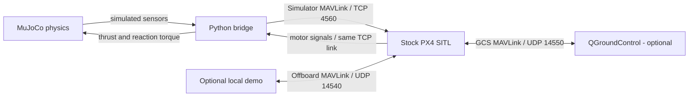

# PX4 MuJoCo Bridge

A lightweight Simulator MAVLink connection between **stock PX4 SITL** and
**MuJoCo**, with an original primitive-geometry quadrotor example. PX4 runs its
normal estimator, flight controllers and allocator; MuJoCo supplies the physical
plant and simulated sensors. No ROS, Gazebo, custom PX4 patch, CAD download, or
physical flight controller is needed for the example.

**Local draft — not released.** Intended repository: `Holiday-66/px4-mujoco-bridge`.
BSD-3-Clause has been selected for the bridge's own code. The [LICENSE](LICENSE)
uses the maintainer's chosen copyright name, `HolidayHan` (2026). Release-authority
confirmation and publication approval remain pending. This is not yet a cleared public release.
See [release checklist](RELEASE_CHECKLIST.md).

## What it does

- Runs unmodified PX4 SITL with its normal estimator, controllers and allocation.
- Exchanges simulated IMU, magnetometer, barometer, GPS and motor signals over
  MAVLink 2/TCP with lockstep after initialization.
- Includes a small X-quadrotor MJCF model with documented motor order and frames.
- Opens MuJoCo's viewer, or runs headlessly without a display.
- Offers an explicit `--demo`: take off, fly a 1 m square at 2 m, land and disarm.
- Keeps each run's parameters, PX4 log, state trace and result in a new directory.

This is a **software-in-the-loop example**, not a calibrated aircraft digital twin
or a hardware-flight interface. The default launch does **not** arm the vehicle.



## Quick start

Follow [the full setup tutorial](docs/setup.md) first to install the bridge and
build the pinned PX4 version. From this repository with its virtual environment
activated:

```bash
# Replace this with your separate stock PX4 checkout.
PX4_ROOT=/absolute/path/to/PX4-Autopilot

# Viewer + PX4, no automatic arming:
px4-mujoco run --px4 "$PX4_ROOT"
```

For motion, stop that run with Ctrl+C, then explicitly opt into the simulated
flight:

```bash
px4-mujoco run --px4 "$PX4_ROOT" --demo
```

For a terminal-only smoke check or a complete headless demo:

```bash
px4-mujoco run --px4 "$PX4_ROOT" --headless --duration 15
px4-mujoco run --px4 "$PX4_ROOT" --headless --demo
```

Run these commands one at a time. The demo normally finishes in about 45 simulated
seconds; it must observe all five target points, landing and disarming to report
success. Ctrl+C stops the bridge and only the PX4 child it launched. It does not
send a landing command to any real vehicle. QGroundControl is optional and can
remain open on the same machine.

## Tested baseline

| Component | Baseline |
| --- | --- |
| Host | Ubuntu 22.04.5, x86-64 |
| PX4 | `v1.17.0`, `d6f12ad1c4f70ad3230afd7d86e971421e02fef4` |
| Bridge Python | 3.10.19 |
| MuJoCo / NumPy / pymavlink | 3.4.0 / 2.2.6 / 2.4.49 |
| Live validation | Stock build, unarmed lockstep check, takeoff/square/landing demo |

The launcher checks the PX4 commit and refuses tracked source changes by default.
Other versions require `--allow-other-px4` and are compatibility experiments, not
automatically supported. See the [validation record](docs/validation.md) for the
tested boundaries, including GUI and clean-machine setup items not yet verified.

## Documentation

| I want to… | Read |
| --- | --- |
| Install everything and get a first flight | [Setup tutorial](docs/setup.md) |
| Download QGC and understand its connection | [QGroundControl setup](docs/setup.md#qgroundcontrol-optional) |
| Understand timing, frames and motor signals | [Architecture](docs/architecture.md) |
| Change the quadrotor or add my own model | [Model contract](docs/models.md) |
| Diagnose build, connection or flight failures | [Troubleshooting](docs/troubleshooting.md) |
| See what actually passed | [Validation](docs/validation.md) |
| Run tests or propose changes | [Contributing](CONTRIBUTING.md) |

## Scope and attribution

The example uses original primitive geometry. It includes no research-airframe
CAD, proprietary controller, flight logs, firmware binaries or project history.
PX4 is downloaded separately from upstream; Python dependencies are installed
separately. Their licenses remain their own; see [notices](NOTICE.md).

This is an independent integration, not an official PX4, MuJoCo or
QGroundControl distribution. Keep the simulator local and disconnected from
physical flight controllers; see [security and safety scope](SECURITY.md).
